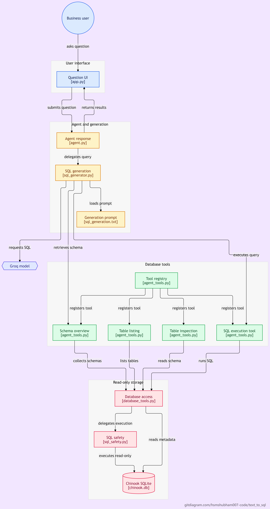

# 🎵 Text-to-SQL Agent

A Python application that converts natural-language business questions into SQL queries for the Chinook SQLite music-store database using Groq and LangChain.

## Features

- Natural-language question answering using a bounded tool-calling agent
- Compact database schema and relationship context
- Six database tools for table listing, schema inspection, database overview, SQL execution, distinct-value lookup, and arithmetic
- SQLGlot validation before execution
- Read-only SQLite connections that prevent database writes
- Automatic row limiting for query results
- Bounded SQL correction and retry logic
- Configured refusals for unsupported question categories
- Streamlit UI displaying answers, generated SQL, and query results
- Automated tests for agent behavior, SQL safety, evaluation logic, and database tools
- A 35-question evaluation dataset: 30 answerable and 5 unanswerable questions

## Architecture Diagram



The diagram illustrates the main components and flow of the Text-to-SQL Agent, from natural-language questions through SQL generation and validation to read-only database execution and results.


## Requirements

- Python 3.12
- A Groq API key for live model requests
- Dependencies listed in `requirements.txt`

## Setup

Use Python 3.12 and run these commands from the project root in PowerShell.

Create and activate a virtual environment, then install dependencies:

```powershell
py -3.12 -m venv venv
.\venv\Scripts\Activate.ps1
python -m pip install --upgrade pip
python -m pip install -r requirements.txt
```

Create a local `.env` file in the project root:

```text
GROQ_API_KEY=your_groq_api_key
GROQ_MODEL=qwen/qwen3.8-27b
```

Replace the placeholder with your own Groq API key. Never commit `.env` or expose your API key. The application defaults to `qwen/qwen3.8-27b` when `GROQ_MODEL` is not set.

The repository includes the Chinook SQLite database at `data/chinook.db`. Confirm that it exists before running the application.

Live model requests require a valid Groq API key and available API quota. Automated tests and database reference-query audits can run without making live model requests.

## Run the Streamlit UI

From the project root, run:

```powershell
python -m streamlit run .\app.py
```

Open the local URL displayed by Streamlit, usually `http://localhost:8501`.

Enter a business question and select **Ask database**. The interface displays the natural-language answer, generated SQL when available, query results, returned row count, and SQL execution attempts.

Unsupported questions can be refused without contacting Groq. Live supported questions require available Groq API quota.

## Agent architecture

- `app.py` — Streamlit user interface
- `src/agent.py` — bounded tool-calling agent and structured response
- `src/agent_tools.py` — four LangChain database tools
- `src/sql_generator.py` — SQL generation, unsupported-question checks, validation, and correction logic
- `src/sql_safety.py` — SQL validation and read-only execution safeguards
- `src/database_tools.py` — database table inspection and query execution
- `src/inspect_schema.py` — schema inspection utility
- `data/chinook.db` — SQLite database
- `prompts/sql_generation.txt` — SQL-generation prompt
- `evals/` — evaluation scripts, golden set, audits, and result reports
- `tests/` — automated tests
- `docs/SCHEMA.md` — database schema documentation
- `docs/EVALUATION_RESULTS.md` — recorded measurements, limitations, and failed evaluation attempts

## Database tools

The agent exposes six registered tools:

1. `list_database_tables` - lists available database tables.
2. `inspect_schema` - inspects a table's columns, types, primary key, and foreign keys.
3. `get_database_overview` - returns database tables and schema information.
4. `run_query` - executes a validated, read-only SQL query.
5. `get_distinct_values` - retrieves distinct column values to help resolve uncertain filters.
6. `calculate` - evaluates basic arithmetic using a restricted expression evaluator.

Generated SQL must pass the SQL safety layer before execution. The database connection is read-only, destructive SQL is rejected, and query results are limited to 100 rows.

## Run tests

```powershell
$env:PYTHONPATH = (Get-Location).Path
pytest -q
```

Latest local verification: **77 tests passed**. This result was confirmed after the latest SQL safety changes.

Run the dataset and reference-query audits separately when needed:

```powershell
python .\evals\audit_golden_set.py
python .\evals\audit_reference_sql.py
```

The last recorded audits passed all 30 golden-set consistency checks and executed all 30 reference SQL queries successfully without Groq API calls.

## Evaluation status

The evaluation dataset contains 30 answerable questions and 5 unanswerable questions.

Evaluation history includes a recorded initial model run that passed 11 of 30 answerable questions (36.67%) and correctly refused all 5 unanswerable questions. A later attempt passed 8 questions, recorded 1 incorrect result, and encountered 21 API errors caused by Groq token-per-day rate limits.

The incomplete run's 26.67% pass rate is not a valid full-run accuracy measurement. The latest complete evaluation subsequently passed all 30 answerable questions (100%) and correctly refused all 5 unanswerable questions, with zero reported failures. Historical results are retained for transparency. See docs/EVALUATION_RESULTS.md for the evaluation history and limitations.

See `docs/EVALUATION_RESULTS.md` for the recorded measurements, failed attempts, and limitations.

## Safety and limitations

SQLGlot validation, read-only SQLite connections, and result limits reduce the risk of destructive queries. They do not guarantee that generated SQL is correct or that every natural-language question is interpreted accurately.

The latest complete live evaluation tested 30 answerable questions and 5 unanswerable questions. It passed all 30 answerable questions (100%) and correctly refused all 5 unanswerable questions, with zero reported failures. The evaluation took approximately 598.5 seconds. These results describe the recorded evaluation dataset and do not guarantee the same accuracy on new questions.

Earlier evaluation attempts encountered incorrect answers and Groq token-per-day rate limits. Historical results and limitations are documented in `docs/EVALUATION_RESULTS.md`.

The project has a passing local test suite and recorded evaluation results, but it has not been demonstrated to be production-ready. Clean-clone reproducibility and deployment readiness must be verified separately.